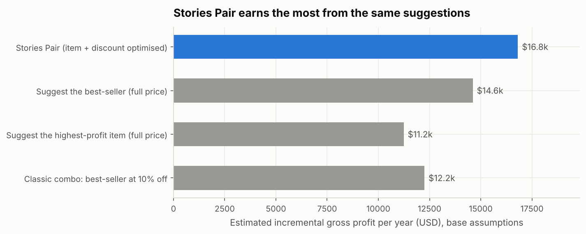

# Stories Pair
### Turning half-orders into profitable pairs, one till suggestion at a time

**EECE 490 Hackathon · Stories Coffee transaction data (Jan–Jun 2026, 3 branches, 33,887 orders)**
**Team:** ‹Member 1 full name› · ‹Member 2 full name›

---

## Conclusion in one paragraph

**72% of Stories' orders are half a pair** (40.9% drink-only, 30.9% food-only). We tested what the data can actually support before building anything. Classic "people who bought X also bought Y" analysis finds nothing, but when an order *does* pair, the **category** of the add-on is strongly predictable (a matcha or tea rung first is followed by bakery 78% of the time; a sandwich or meal by a cold drink 41% of the time, vs 18% overall). Below the category level, the specific product, the customer's loyalty ID, the time of day and the branch add nothing that survives testing on unseen months, and discounts did not change baskets. **Stories Pair** uses exactly that: when the first item is rung, it suggests the item from the other side with the highest *expected incremental gross profit* at that branch, net of the customers who would have bought it anyway. The whole engine compiles to a **135-row lookup table** a POS can use tomorrow. At base assumptions it adds an estimated **~$17k of gross profit a year (P10–P90: $12k–$27k)**, 15% more than suggesting the best-seller and 37% more than a classic 10%-off combo, which would also hand ~$3.9k a year in discounts to customers who would have paid full price. The one number that matters and cannot be measured from history, **acceptance**, is measured by a 2-week logging pilot, then confirmed by a 6-week odd/even-receipt A/B test.

---

## What we measured (facts from the data)

| # | Finding | Evidence | Notebook |
|---|---|---|---|
| 1 | 72% of orders contain only one side of the pair | 13,865 drink-only + 10,459 food-only of 33,887 | [00](notebooks/00_data_contract.ipynb) |
| 2 | Whether an order pairs depends on **what is rung first**, not on branch, hour, weekday, order type or loyalty | χ² Cramér's V 0.08–0.18 for first-item category vs ≤ 0.03 for every context variable | [01](notebooks/01_eda_attach_gap.ipynb) |
| 3 | **Which** category is added depends strongly on the first item's category | χ² p < 1e-100, V 0.19–0.22 by direction | [01](notebooks/01_eda_attach_gap.ipynb), [02](notebooks/02_pair_evidence.ipynb) |
| 4 | Classic market basket finds **no** significant product pair; every category lift over all orders is ≤ 1 | 0 of 506 product pairs at BH q < 0.05 | [02](notebooks/02_pair_evidence.ipynb) |
| 5 | Inside a category, the specific product is **independent** of the drink | 0 of 20 within-category tests survive Bonferroni | [02](notebooks/02_pair_evidence.ipynb) |
| 6 | Loyalty IDs carry **no personal preference** | Repeat-choice rate = chance (z = −0.85); 94% of IDs seen at 2+ branches | [02](notebooks/02_pair_evidence.ipynb) |
| 7 | A simple rate-by-first-category baseline **ties** logistic regression and **beats** gradient boosting on unseen June orders | June AUC 0.597 vs 0.593 vs 0.587; bootstrap CIs include or favour the baseline | [03](notebooks/03_receptiveness_model.ipynb) |
| 8 | Discounts did not create pairs | Naive view 34% vs 25% is a counting artifact; first drink discounted vs not: 25.1% vs 25.7%, p = 0.65 | [01](notebooks/01_eda_attach_gap.ipynb) |
| 9 | Garden pays **1.43×** Harbour's unit cost on all 45 products while pricing 5% lower | Ratio 1.426–1.439 on every product, incl. bottled water | [01](notebooks/01_eda_attach_gap.ipynb) |

## The engine

When the first item is rung, score every item *i* on the other side at every discount *d* (0–15%):

```
expected gain = (1 − Q) · a_i(d) · gp_i(d)              new sales from people who would not have added anything
              −  Q · s_i · (p_i − p_i(d))                discount handed to people who would have bought i anyway
              +  w · Q · (1 − s_i) · (gp_i(d) − gp_other) people who switch to the suggestion
```

| Term | Meaning | Status |
|---|---|---|
| Q | chance the order pairs anyway (rate by first-item category) | **measured** |
| s_i | chance the add-on is item *i* (category share × within-category share) | **measured** |
| gp_i, p_i | gross profit and price **at this branch** | **measured** |
| a_i(d) | acceptance by people who would not have added anything; ∝ how often the item is chosen organically | **assumed** (6% for an average item) |
| w | share of organic buyers who switch to the suggestion | **assumed** (10%) |

Guardrails (editable in [`config/guardrails.json`](config/guardrails.json)): discount ≤ 15% (deepest in Stories' data), ≥ 40% margin after discount, add-on ≤ 2.5× the first item's price (no $11 sandwich pushed onto a $4 coffee), no suggestion worth < $0.05, never repeat a declined offer.

What it does in practice ([04](notebooks/04_engine_and_pricing.ipynb)):

- **Never discounts at base assumptions.** Discounts start to pay only if 10% off lifts acceptance by about a quarter or more; Stories' data shows no lift at all.
- **Branch-aware.** At Garden, iced coffees and cold drinks are paired with an Egg Sandwich; at Harbour and Uptown, with a Chicken Pesto Sandwich, because that sandwich earns $3.36 a unit at Garden vs $6.12 at Harbour.
- **Day-one deployable.** The chosen models depend only on branch and first item, so [`outputs/playbook.csv`](outputs/playbook.csv) (135 rows) *is* the engine. Refresh monthly.

## What it is worth (estimates, not measurements)

Engine trained on Jan–May, replayed on all 6,906 June orders, scaled to a year ([05](notebooks/05_value_and_pilot.ipynb)):

| Policy (same suggestions, same acceptance model) | Incremental gross profit / yr | Discount handed out / yr |
|---|---:|---:|
| **Stories Pair** | **$16,811** | $0 |
| Suggest the best-seller, full price | $14,608 | $0 |
| Classic combo: best-seller at 10% off | $12,249 | $3,858 |
| Suggest the highest-profit item | $11,236 | $0 |

- Varying every assumption at once (400 draws): **P10 $11.8k · median $18.5k · P90 $26.9k**; no draw loses money.
- **Acceptance is the dominant uncertainty**: each percentage point is worth about $2,650 a year.
- The classic combo only catches up if 10% off lifts acceptance by +40–50%, far beyond anything in the data.
- These are **gross-profit** figures: they exclude staff time, waste and POS integration cost.



## The pilot Stories can run next month

1. **Acceptance logging, 2 weeks, all branches.** Staff make the playbook suggestion and tap accepted/declined (the demo in [06](notebooks/06_pos_demo.ipynb) shows the flow). ~2,200 suggestions estimate acceptance to ±1 point. If acceptance is below ~2%, stop.
2. **Odd/even receipt A/B test, 6 weeks, all branches.** Even Transaction IDs get the suggestion, odd ones don't: no customer data, nothing for staff to remember. Detects ~$0.18 extra gross profit per order at 80% power (base case predicts $0.25).
3. Re-fit monthly with the logged responses, so acceptance becomes a measured input. Test a discounted variant only after step 2 succeeds, on one branch.

## What we rejected, and why

| Approach | Why not |
|---|---|
| Product-level market basket / association rules | No significant pairs; on June data it is no better than plain popularity ([02](notebooks/02_pair_evidence.ipynb)) |
| Customer-level personalisation | Loyalty IDs show no personal preference and behave like a shared pool ([02](notebooks/02_pair_evidence.ipynb)) |
| Gradient boosting / context-heavy ML for "will they pair" | Ties or loses to a one-line baseline on unseen months ([03](notebooks/03_receptiveness_model.ipynb)) |
| Blanket combo discounts | Pays customers who would buy anyway; no discount effect in the data ([01](notebooks/01_eda_attach_gap.ipynb), [05](notebooks/05_value_and_pilot.ipynb)) |
| Merging receipts with the same branch + second | 30 collisions vs ~21 expected by chance ([00](notebooks/00_data_contract.ipynb)) |
| "Breakfast only before noon" rule | 56% of breakfast items sell after 3 pm |

## Weak spots and what could change the answer

- **Acceptance is assumed.** Everything in "What it is worth" scales with it; the pilot exists to measure it.
- **Ring order is assumed.** The export has no ring order; we treat the first line as the first item rung. Supporting evidence: the add-on depends more strongly on the first line (V 0.19–0.22) than in the pooled view (0.15) ([02](notebooks/02_pair_evidence.ipynb)).
- **Discount evidence is observational.** Line discounts look randomly applied, but a discount shown upfront on an add-on is a different intervention; we test it only after the full-price pilot.
- **Six months, not a year.** Pairing rates are flat month to month (25–27% drink-first, notebook 01), but full-year seasonality cannot be checked; order volume grows each month, so we annualise from the six-month average rather than from June.
- **Gross profit, not net.** Labour, waste and integration costs are not in the data.
- **The Garden cost gap is unexplained** (supplier terms, recipe, waste or accounting allocation). Bringing Garden to Harbour-level unit costs would be worth up to ~$32k a year on its own, and would raise the value of every suggestion made there.

## Repository

| Path | What it is |
|---|---|
| [`notebooks/00_data_contract.ipynb`](notebooks/00_data_contract.ipynb) | Data checks, order definition, order mix |
| [`notebooks/01_eda_attach_gap.ipynb`](notebooks/01_eda_attach_gap.ipynb) | Where the pairing gap is; unit economics; discount check |
| [`notebooks/02_pair_evidence.ipynb`](notebooks/02_pair_evidence.ipynb) | Product vs category pairs, customer IDs, held-out benchmark |
| [`notebooks/03_receptiveness_model.ipynb`](notebooks/03_receptiveness_model.ipynb) | Models vs baselines on unseen June orders |
| [`notebooks/04_engine_and_pricing.ipynb`](notebooks/04_engine_and_pricing.ipynb) | The engine, discount logic, playbook |
| [`notebooks/05_value_and_pilot.ipynb`](notebooks/05_value_and_pilot.ipynb) | Value, sensitivity, pilot design |
| [`notebooks/06_pos_demo.ipynb`](notebooks/06_pos_demo.ipynb) | Till prototype (Gradio app in Colab) |
| [`src/storiespair/`](src/storiespair) | Shared code: data, evidence, models, engine, simulate, viz |
| [`config/`](config) | Assumptions, guardrails, compatibility: business-editable, no code |
| [`outputs/`](outputs) | Figures, tables and the playbook |

**Run it in Google Colab:** open any notebook below and *Run all*. The first cell clones this repo; everything else is preinstalled in Colab (notebook 06 installs Gradio itself).

[](https://colab.research.google.com/github/mouhammed-soumaille/EECE-490-Hackathon/blob/main/notebooks/00_data_contract.ipynb)
[](https://colab.research.google.com/github/mouhammed-soumaille/EECE-490-Hackathon/blob/main/notebooks/01_eda_attach_gap.ipynb)
[](https://colab.research.google.com/github/mouhammed-soumaille/EECE-490-Hackathon/blob/main/notebooks/02_pair_evidence.ipynb)
[](https://colab.research.google.com/github/mouhammed-soumaille/EECE-490-Hackathon/blob/main/notebooks/03_receptiveness_model.ipynb)
[](https://colab.research.google.com/github/mouhammed-soumaille/EECE-490-Hackathon/blob/main/notebooks/04_engine_and_pricing.ipynb)
[](https://colab.research.google.com/github/mouhammed-soumaille/EECE-490-Hackathon/blob/main/notebooks/05_value_and_pilot.ipynb)
[](https://colab.research.google.com/github/mouhammed-soumaille/EECE-490-Hackathon/blob/main/notebooks/06_pos_demo.ipynb)

Every notebook is committed with its outputs, so results can be inspected on GitHub without running anything.
