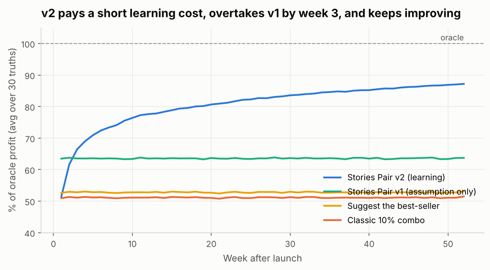

# Stories Pair
### Turning half-orders into profitable pairs, one till suggestion at a time

**EECE 490 Hackathon · Stories Coffee transaction data (Jan–Jun 2026, 3 branches, 33,887 orders)**
**Team:** Mouhammed Soumaille · Wassim Shams

**Start here:** 📄 [Project report (PDF)](reports/Stories_Pair_Report.pdf) · 🧾 [Till app](app/index.html) (download and open in any browser) · 📓 [Notebooks](notebooks) · 🎤 [Pitch deck slides](presentation)

---

## Conclusion

**72% of Stories' orders are half a pair** (40.9% drink-only, 30.9% food-only). We tested what the data can actually support before building anything. Classic "people who bought X also bought Y" analysis finds nothing, but when an order *does* pair, the **category** of the add-on is strongly predictable (a matcha or tea rung first is followed by bakery 78% of the time; a sandwich or meal by a cold drink 41% of the time, vs 18% overall). Below the category level, the specific product, the customer's loyalty ID, the time of day and the branch add nothing that survives testing on unseen months, and discounted drinks were not associated with more pairing. **Stories Pair** uses exactly that: when the first item is rung, it suggests the item from the other side with the highest *expected incremental gross profit* at that branch, net of the customers who would have bought it anyway. The whole engine compiles to a **135-row lookup table** a POS can use tomorrow. At base assumptions it adds an estimated **~$17k of gross profit a year (~$16.5k after staff time; P10–P90: $12k–$27k)**, 15% more than suggesting the best-seller and 37% more than a classic 10%-off combo, which gives away ~$3.9k a year in discounts for little extra uptake. The one number that matters and cannot be measured from history, **acceptance**, is measured by a 2-week logging pilot, then confirmed by a 6-week odd/even-receipt A/B test. From then on, **Stories Pair v2**, a Thompson-sampling bandit, learns acceptance from every accept and decline; in simulation across 30 hidden customer truths it earns **27% more than the fixed engine in its first year** and beats the best-seller rule and the classic combo in all 30.

---

## Original findings

1. **Classic market-basket lift is the wrong tool here.** Over all orders every drink × food lift is ≤ 1, because 72% of orders are single-sided; a team stopping there concludes "no pairs". Conditioning on orders that pair reveals strong category pairs (cold drinks + sandwiches, lift 1.8). ([02](notebooks/02_pair_evidence.ipynb))
2. **The pairing signal stops at the category.** 0 of 20 within-category tests survive correction, so the specific item can be chosen by profit at no cost in relevance. ([02](notebooks/02_pair_evidence.ipynb))
3. **Line order inside an order carries information.** The add-on is more strongly associated with the first line (Cramér's V 0.19–0.22) than in the pooled view (0.15), which lets the engine treat the first line as the item rung first. ([02](notebooks/02_pair_evidence.ipynb))
4. **The "discounts sell more food" pattern is a counting artifact** of bigger orders (34% vs 25% naive; 25.1% vs 25.7% when only the first drink's discount is compared). ([01](notebooks/01_eda_attach_gap.ipynb))
5. **Loyalty IDs carry no personal preference** (repeat-choice rate equals chance, 94% of IDs seen at several branches), so personalisation is not worth its privacy cost on this data. ([02](notebooks/02_pair_evidence.ipynb))
6. **A one-line baseline matches machine learning** for predicting whether an order pairs (June AUC 0.597 vs 0.593 vs 0.587), so the deployed model is the simple one. ([03](notebooks/03_receptiveness_model.ipynb))
7. **Branch costs change the right suggestion:** Garden's 1.43× unit costs flip 7 of its 45 suggestions. ([04](notebooks/04_engine_and_pricing.ipynb), [05](notebooks/05_value_and_pilot.ipynb))
8. **What a pair is worth, from measured margins.** Paired orders earn $7.46 of gross profit vs $4.44 for half-orders (+68%, an association: paired orders are bigger in general). The add-on itself earns $3.55, so **every 1% of half-orders turned into pairs is worth ~$1,740 a year** without any acceptance assumption (it does assume a converted order adds a typical add-on and replaces no later purchase); the $16.8k base case means converting ~9.7% of them. ([08](notebooks/08_value_and_stability.ipynb))
9. **The engine is stable.** Retrained on Jan–Mar vs Apr–Jun, 66% of suggestions are identical and the rest swap between near-equal options; a three-month-old playbook still keeps **96.4%** of the value, so a monthly refresh is plenty. ([08](notebooks/08_value_and_stability.ipynb))

---

## What we measured

| # | Finding | Evidence | Notebook |
|---|---|---|---|
| 1 | 72% of orders contain only one side of the pair | 13,865 drink-only + 10,459 food-only of 33,887 | [00](notebooks/00_data_contract.ipynb) |
| 2 | Whether an order pairs varies with **what is rung first**, not with branch, hour, weekday, order type or loyalty | χ² Cramér's V 0.08–0.18 for first-item category vs ≤ 0.03 for every context variable | [01](notebooks/01_eda_attach_gap.ipynb) |
| 3 | **Which** category is added varies strongly with the first item's category | χ² p < 1e-100, V 0.19–0.22 by direction | [01](notebooks/01_eda_attach_gap.ipynb), [02](notebooks/02_pair_evidence.ipynb) |
| 4 | Classic market basket finds **no** significant product pair; every category lift over all orders is ≤ 1 | 0 of 506 product pairs at BH q < 0.05 | [02](notebooks/02_pair_evidence.ipynb) |
| 5 | Inside a category, the specific product is **independent** of the drink | 0 of 20 within-category tests survive Bonferroni | [02](notebooks/02_pair_evidence.ipynb) |
| 6 | Loyalty IDs carry **no personal preference** | Repeat-choice rate = chance (z = −0.85); 94% of IDs seen at 2+ branches | [02](notebooks/02_pair_evidence.ipynb) |
| 7 | A simple rate-by-first-category baseline **ties** logistic regression and **beats** gradient boosting on unseen June orders | June AUC 0.597 vs 0.593 vs 0.587; bootstrap CIs include or favour the baseline | [03](notebooks/03_receptiveness_model.ipynb) |
| 8 | Discounted orders did not pair more (association, not a test) | Naive view 34% vs 25% is a counting artifact; first drink discounted vs not: 25.1% vs 25.7%, p = 0.65 | [01](notebooks/01_eda_attach_gap.ipynb) |
| 9b | A paired order earns **$7.46** gross profit vs **$4.44** for a half-order (+68%); the add-on itself earns $3.55 | Welch t-test p < 1e-10 | [08](notebooks/08_value_and_stability.ipynb) |
| 9 | Garden pays **1.43×** Harbour's unit cost on all 45 products while pricing 5% lower | Ratio 1.426–1.439 on every product, incl. bottled water | [01](notebooks/01_eda_attach_gap.ipynb) |

## The engine

When the first item is rung, score every item *i* on the other side at every discount *d* (0–15%):

```
expected gain = (1 − Q) · a_i(d) · gp_i(d)              new sales from people who would not have added anything
              −  Q · s_i · (p_i − p_i(d))                discount handed to people who would have bought i anyway
              +  w · Q · (1 − s_i) · (gp_i(d) − gp_other) people who switch to the suggestion
```

| Term | Meaning | Status |
|---|---|---|
| Q | chance the order pairs anyway (rate by first-item category) | **measured** |
| s_i | chance the add-on is item *i* (category share × within-category share) | **measured** |
| gp_i, p_i | gross profit and price **at this branch** | **measured** |
| a_i(d) | acceptance by people who would not have added anything; ∝ how often the item is chosen organically | **assumed** (6% for an average item) |
| w | share of organic buyers who switch to the suggestion | **assumed** (10%) |

Guardrails (editable in [`config/guardrails.json`](config/guardrails.json)): discount ≤ 15% (deepest in Stories' data), ≥ 40% margin after discount, add-on ≤ 2.5× the first item's price (no $11 sandwich pushed onto a $4 coffee), no suggestion worth < $0.05, never repeat a declined offer.

What it does in practice ([04](notebooks/04_engine_and_pricing.ipynb)):

- **Never discounts at base assumptions.** Discounts start to pay only if 10% off lifts acceptance by about a quarter or more; in Stories' data, discounted drinks were not associated with any more pairing.
- **Branch-aware.** At Garden, iced coffees and cold drinks are paired with an Egg Sandwich; at Harbour and Uptown, with a Chicken Pesto Sandwich, because that sandwich earns $3.36 a unit at Garden vs $6.12 at Harbour.
- **Day-one deployable.** The chosen models depend only on branch and first item, so [`outputs/playbook.csv`](outputs/playbook.csv) (135 rows) *is* the engine. Refresh monthly.

## What it is worth (estimates)

Engine trained on Jan–May, replayed on all 6,906 June orders, scaled to a year ([05](notebooks/05_value_and_pilot.ipynb)):

| Policy (same suggestions, same acceptance model) | Incremental gross profit / yr | Discount handed out / yr |
|---|---:|---:|
| **Stories Pair** | **$16,811** | $0 |
| Suggest the best-seller, full price | $14,608 | $0 |
| Classic combo: best-seller at 10% off | $12,249 | $3,858 |
| Suggest the highest-profit item | $11,236 | $0 |

- Varying every assumption at once (400 draws): **P10 $11.8k · median $18.5k · P90 $26.9k**; no draw loses money.
- **Acceptance is the dominant uncertainty**: each percentage point is worth about $2,650 a year.
- The classic combo only catches up if 10% off lifts acceptance by +40–50%, far beyond anything in the data.
- These are **gross-profit** figures: they exclude staff time, waste and POS integration cost.


## Assumptions

Every value figure rests on these. They live in [`config/assumptions.json`](config/assumptions.json); notebook [05](notebooks/05_value_and_pilot.ipynb) varies each one.

| Assumption | Base (range) | Why this value | Effect on the answer |
|---|---|---|---|
| Acceptance of an average-appeal suggestion by people who would not have added anything | 6% (3–12%) | Not measurable: Stories has never logged suggestions | **Largest.** Each point ≈ $2,650 a year; 3% → $8.9k, 12% → $33.1k |
| Acceptance ∝ how often an item is chosen organically | – | Popular items are easier to accept; replaced by learned rates in v2 | v2 simulation lets it be wrong by ±60% per item |
| Extra acceptance per 10% off | +10% (0–50%) | Discounted drinks were not associated with more pairing | Decides whether discounts are used; flips at ~+25% |
| Organic buyers who switch to the suggestion | 10% (0–25%) | Not measurable without logs | $16.3k–$18.7k a year |
| Share of orders where staff make the suggestion | 80% (50–100%) | Compliance in a busy shop | Scales value: $10.5k–$21.0k |
| The first line of an order is the item rung first | – | Export has no ring order; supported by finding 3 | If wrong, the engine still uses the right category pairs; only the "who pairs anyway" rates shift |
| Staff time and wage | 5 s per suggestion, $4/hour (3–8 s, $2.5–6) | Placeholder; Stories should use its own | $114–$729 a year |

## Costs and tradeoffs ([05](notebooks/05_value_and_pilot.ipynb), section 7)

| Cost | Estimate | Note |
|---|---:|---|
| Staff time at the till | **~$300 / yr** (76 hours) | 54,700 suggestions × 5 s × $4/hour; $114–$729 across the ranges |
| Net gain after staff time | **~$16,500 / yr** | Base assumptions, gross profit |
| POS integration (one-off, unknown) | pays back in **0.7 / 2.2 / 3.6 / 7.3 months** | for $1k / $3k / $5k / $10k |
| Discounts handed out | $0 | vs $3,858 / yr for a classic 10% combo |

Tradeoffs not priced: customer annoyance (mitigated: one suggestion per order, none on a complete pair, no repeat after a decline, staff may skip), demand concentrating on a few items (stock and waste are not in the data), and staff compliance.

## What would change the recommendation

| Recommendation | Changes if | How we will know |
|---|---|---|
| Make suggestions at all | Never on staff time alone: a suggestion costs ~$0.006 of staff time and the engine only makes ones worth ≥ $0.05 | Built into the engine |
| Roll out and pay for POS integration | Acceptance below **2.0%** (needed to clear staff time plus a $5k integration in year one, with no switching benefit) | Pilot step 1 |
| No discounts on add-ons | 10% off lifts acceptance by **~25% or more** | One-branch test after step 2; v2 learns it automatically |
| Different suggestions at Garden | Garden's unit costs fall to Harbour's: **7 of 45** Garden suggestions change | Stories' supplier and recipe records |
| Six-week A/B test is long enough | True effect under ~$0.18 per order: extend to 8–10 weeks | Pilot step 1 |

**Missing information** that would sharpen the answer: suggestion and acceptance logs (none exist yet), POS ring order, labour cost per hour, waste and stock levels, POS integration cost, customer complaints, and the reason for Garden's 1.43× unit costs.

## Stories Pair v2: the engine that learns ([07](notebooks/07_learning_engine.ipynb))

v1 has to *assume* how often customers accept a suggestion. v2 learns it: every (first-item category, suggested item, discount) arm keeps a Beta belief about its take rate, warm-started at v1's estimate; for each order the engine samples from every allowed arm's belief, values the draw with that branch's prices and costs, and suggests the best draw (Thompson sampling). Each night the day's accept/decline log updates the beliefs. No retraining, no GPU, no customer data.

Tested against 30 simulated truths (acceptance, discount effect and switching drawn from the assumption ranges, plus ±60% item-level deviations from v1's rule), one year of orders resampled from real April–June orders:

| Policy | First-year extra gross profit (mean) | P10–P90 | v2 wins in |
|---|---:|---:|---:|
| Oracle (knows the truth) | $33,387 | $22.8k–$42.7k | – |
| **Stories Pair v2 (learning)** | **$27,379** | $17.6k–$38.5k | – |
| Stories Pair v1 (assumption only) | $21,478 | $15.0k–$33.6k | 87% of truths |
| Suggest the best-seller | $17,938 | $10.8k–$27.5k | 100% |
| Classic 10% combo | $17,425 | $10.4k–$26.4k | 100% |

v2 pays a short exploration cost (51% of the oracle's profit in week 1 vs 64% for v1), overtakes v1 by week 3 and reaches 87% of the oracle by week 52; its beliefs converge on the true take rates, and its discount use tracks the true discount effect (r = 0.72) without being told. These figures span the whole assumption range, so compare them within this table, not with the base case above. **It is a simulation built on our model's structure; the pilot provides the real numbers.**



## The product

- **Till app** ([`app/index.html`](app/index.html), one self-contained file, no server): ring the first item, see the suggested pairing with its price and a one-line script, tap accept or decline. A staff panel shows the options the engine scored, the chance the order pairs anyway, and the engine's live belief curve. A second tab runs a four-week simulated service of v2 vs v1 vs a classic combo; a third shows the business case. Its JavaScript engine reproduces the Python engine's decisions exactly. Rebuild with `python app/build_app.py`.
- **Colab demo** ([06](notebooks/06_pos_demo.ipynb)): the same flow as a Gradio app with a public share link.
- **Integration path:** day one, load [`outputs/playbook.csv`](outputs/playbook.csv) into the POS; during the pilot, log accept/decline; then a nightly job updates two counts per arm and republishes the table.

## The pilot Stories can run next month

1. **Acceptance logging, 2 weeks, all branches.** Staff make the playbook suggestion and tap accepted/declined (the demo in [06](notebooks/06_pos_demo.ipynb) shows the flow). ~2,200 suggestions estimate acceptance to ±1 point. If acceptance is below ~2%, stop.
2. **Odd/even receipt A/B test, 6 weeks, all branches.** Even Transaction IDs get the suggestion, odd ones don't: no customer data, nothing for staff to remember. Detects ~$0.18 extra gross profit per order at 80% power (base case predicts $0.25).
3. Re-fit monthly with the logged responses, so acceptance becomes a measured input. Test a discounted variant only after step 2 succeeds, on one branch.

## What we rejected, and why

| Approach | Why not |
|---|---|
| Product-level market basket / association rules | No significant pairs; on June data it is no better than plain popularity ([02](notebooks/02_pair_evidence.ipynb)) |
| Customer-level personalisation | Loyalty IDs show no personal preference and behave like a shared pool ([02](notebooks/02_pair_evidence.ipynb)) |
| Gradient boosting / context-heavy ML for "will they pair" | Ties or loses to a one-line baseline on unseen months ([03](notebooks/03_receptiveness_model.ipynb)) |
| Blanket combo discounts | Costs more margin than the small extra uptake it buys (about a third of the discount goes to people who would have bought anyway); no association between discounts and pairing in the data ([01](notebooks/01_eda_attach_gap.ipynb), [05](notebooks/05_value_and_pilot.ipynb)) |
| Merging receipts with the same branch + second | 30 collisions vs ~21 expected by chance ([00](notebooks/00_data_contract.ipynb)) |
| "Breakfast only before noon" rule | 56% of breakfast items sell after 3 pm |

## Weak spots and what could change the answer

- **Acceptance is assumed.** Everything in "What it is worth" scales with it; the pilot exists to measure it.
- **Ring order is assumed.** The export has no ring order; we treat the first line as the first item rung. Supporting evidence: the add-on depends more strongly on the first line (V 0.19–0.22) than in the pooled view (0.15) ([02](notebooks/02_pair_evidence.ipynb)).
- **Discount evidence is observational.** Line discounts look randomly applied, but a discount shown upfront on an add-on is a different intervention; we test it only after the full-price pilot.
- **Six months, not a year.** Pairing rates are flat month to month (25–27% drink-first, notebook 01), but full-year seasonality cannot be checked; order volume grows each month, so we annualise from the six-month average rather than from June.
- **Gross profit, not net.** Labour, waste and integration costs are not in the data.
- **The Garden cost gap is unexplained** (supplier terms, recipe, waste or accounting allocation). Bringing Garden to Harbour-level unit costs would be worth up to ~$32k a year on its own, and would raise the value of every suggestion made there.

## Repository

| Path | What it is |
|---|---|
| [`notebooks/00_data_contract.ipynb`](notebooks/00_data_contract.ipynb) | Data checks, order definition, order mix |
| [`notebooks/01_eda_attach_gap.ipynb`](notebooks/01_eda_attach_gap.ipynb) | Where the pairing gap is; unit economics; discount check |
| [`notebooks/02_pair_evidence.ipynb`](notebooks/02_pair_evidence.ipynb) | Product vs category pairs, customer IDs, held-out benchmark |
| [`notebooks/03_receptiveness_model.ipynb`](notebooks/03_receptiveness_model.ipynb) | Models vs baselines on unseen June orders |
| [`notebooks/04_engine_and_pricing.ipynb`](notebooks/04_engine_and_pricing.ipynb) | The engine, discount logic, playbook |
| [`notebooks/05_value_and_pilot.ipynb`](notebooks/05_value_and_pilot.ipynb) | Value, sensitivity, pilot design |
| [`notebooks/06_pos_demo.ipynb`](notebooks/06_pos_demo.ipynb) | Till prototype (Gradio app in Colab) |
| [`notebooks/07_learning_engine.ipynb`](notebooks/07_learning_engine.ipynb) | v2: Thompson-sampling bandit, simulation vs fixed rules and oracle |
| [`tests/test_engine.py`](tests/test_engine.py) | 5 automated checks: orders rebuild without loss, June never used for fitting, all 135 playbook rows obey every guardrail, add-ons always from the other side, published playbook matches the code. Run `python tests/test_engine.py` |
| [`notebooks/08_value_and_stability.ipynb`](notebooks/08_value_and_stability.ipynb) | Measured value of a pair; engine stability across quarters |
| [`app/`](app) | Standalone till app (`index.html`) and its build script |
| [`reports/`](reports) | Project report PDF and the script that builds it |
| [`presentation/`](presentation) | Pitch deck slides (HTML source) |
| [`src/storiespair/`](src/storiespair) | Shared code: data, evidence, models, engine, bandit, simulate, viz |
| [`config/`](config) | Assumptions, guardrails, compatibility: business-editable, no code |
| [`outputs/`](outputs) | Figures, tables and the playbook |

**Run it in Google Colab:** open any notebook below and *Run all*. The first cell clones this repo; everything else is preinstalled in Colab (notebook 06 installs Gradio itself).

[](https://colab.research.google.com/github/mouhammed-soumaille/EECE-490-Hackathon/blob/main/notebooks/00_data_contract.ipynb)
[](https://colab.research.google.com/github/mouhammed-soumaille/EECE-490-Hackathon/blob/main/notebooks/01_eda_attach_gap.ipynb)
[](https://colab.research.google.com/github/mouhammed-soumaille/EECE-490-Hackathon/blob/main/notebooks/02_pair_evidence.ipynb)
[](https://colab.research.google.com/github/mouhammed-soumaille/EECE-490-Hackathon/blob/main/notebooks/03_receptiveness_model.ipynb)
[](https://colab.research.google.com/github/mouhammed-soumaille/EECE-490-Hackathon/blob/main/notebooks/04_engine_and_pricing.ipynb)
[](https://colab.research.google.com/github/mouhammed-soumaille/EECE-490-Hackathon/blob/main/notebooks/05_value_and_pilot.ipynb)
[](https://colab.research.google.com/github/mouhammed-soumaille/EECE-490-Hackathon/blob/main/notebooks/06_pos_demo.ipynb)
[](https://colab.research.google.com/github/mouhammed-soumaille/EECE-490-Hackathon/blob/main/notebooks/07_learning_engine.ipynb)
[](https://colab.research.google.com/github/mouhammed-soumaille/EECE-490-Hackathon/blob/main/notebooks/08_value_and_stability.ipynb)

Every notebook is committed with its outputs, so results can be inspected on GitHub without running anything.
